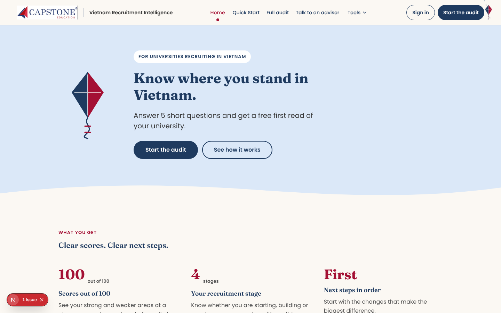
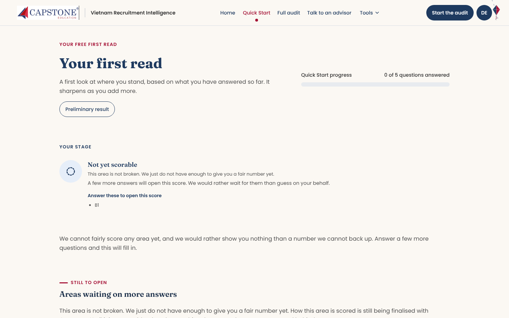
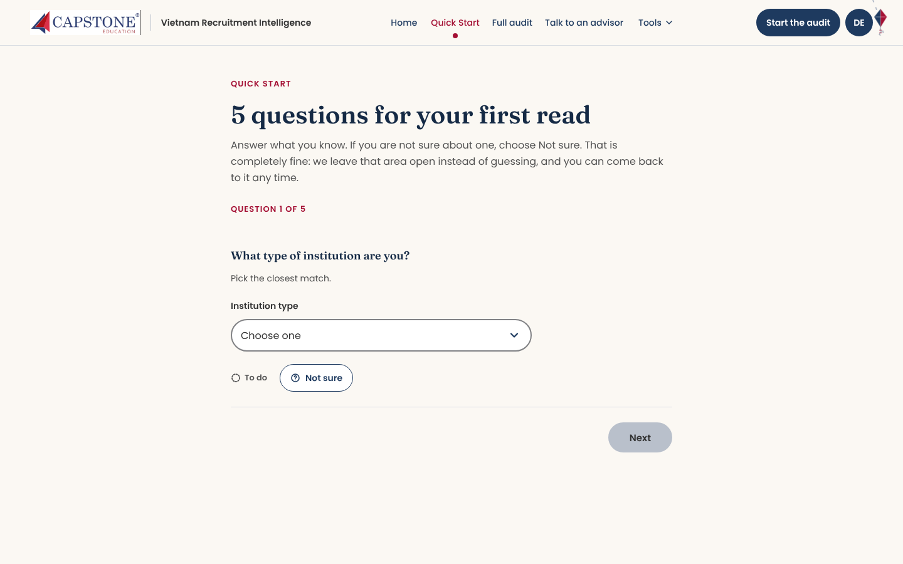
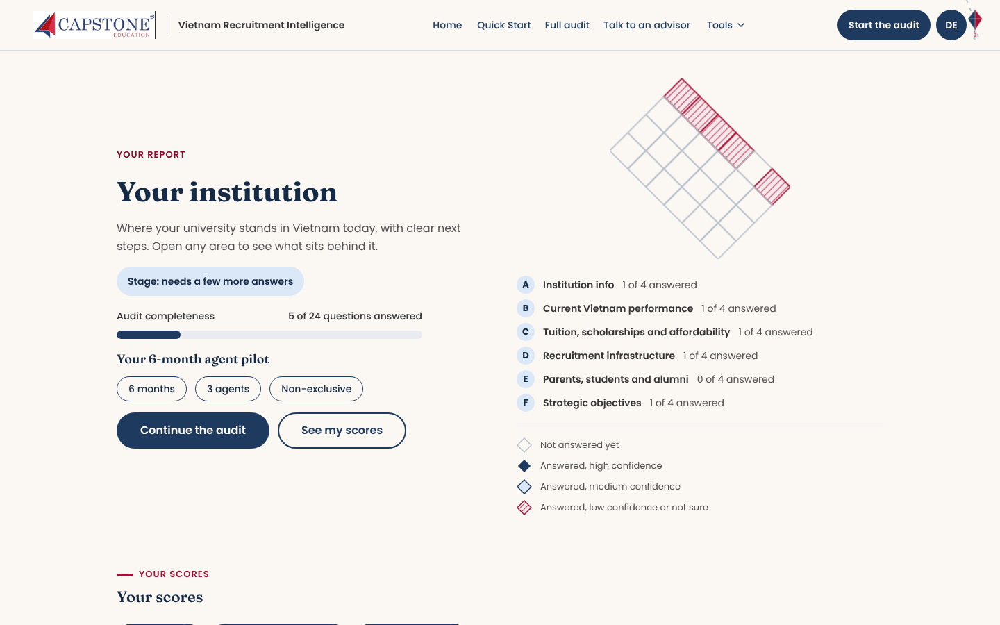
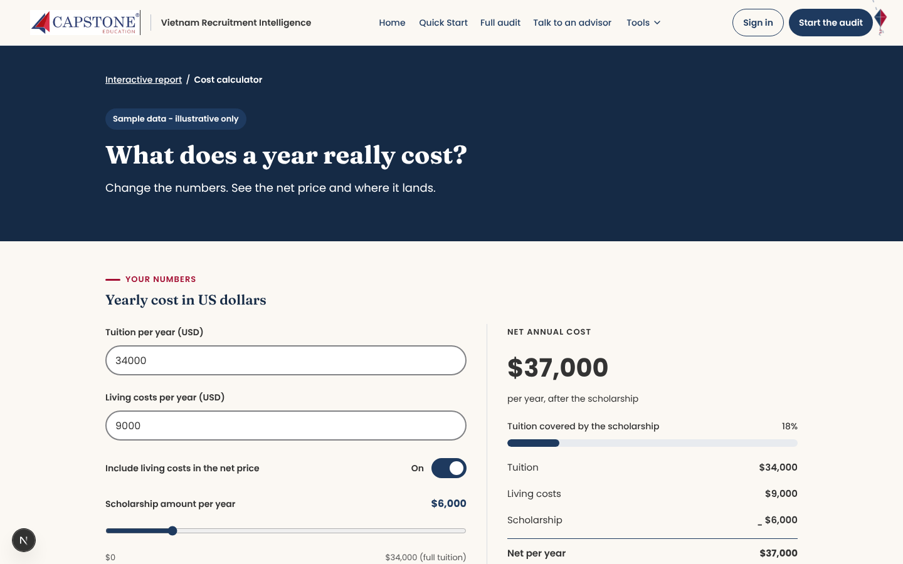
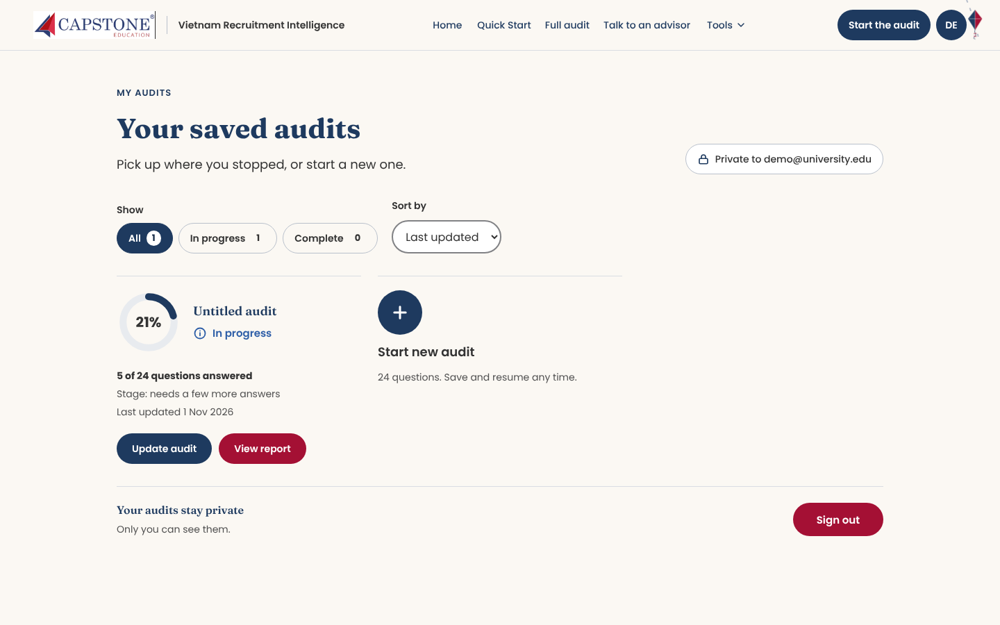

# VRI: Vietnam Recruitment Intelligence

**A web app that audits how ready a foreign university is to recruit students in Vietnam, built for Capstone Education.**

A university answers a short Quick Start (5 questions) or the full audit (24 questions), and gets a report with its recruitment stage, scores by area, next steps, a cost calculator and a 6-month agent pilot plan.



## The idea that shapes the whole project

Not every number the audit needs has been confirmed yet (scoring formulas, prices, contact details, Vietnam statistics). So the app is built around one rule: **never invent data.**

- An unknown value is stored as `null` in one config file and shown as **`[TO BE CONFIRMED WITH CAPSTONE]`**.
- A score that cannot be computed honestly is not shown as `0` or as a guess. It is shown as **"Not yet scorable"**, with the exact answers needed to open it.
- Anything that comes from sample data carries a visible **"Sample data - illustrative only"** badge.
- Scoring runs on the server, from the stored answers plus a **config version**, so changing a weight never silently rewrites old results.



## What is in it

| | |
|---|---|
|  **Quick Start.** Five questions, with a "Not sure" option on every one, so people are never forced to guess. |  **Report.** Audit completeness, a map of answered and unanswered questions with their confidence, and scores by area. |
|  **Cost calculator.** Change tuition, living costs and scholarship and see the real net price. |  **Saved audits.** Sign in with a one-time email link, keep several audits and pick up where you stopped. |

Also built: the full 24-question intake in six sections (with an evidence tag on each answer), agent strategy with a 6-month pilot, a request-an-advisor form (emailed through Resend), PDF export through the browser's print dialog, and the unlock flow for the full report.

## How it is built

**Next.js (App Router) · React 19 · TypeScript (strict) · pnpm · CSS Modules on design tokens · Vitest and Testing Library · Storybook · Playwright.**

The code is split into strict layers, and imports may only point **downward**. This is checked on every run (`dependency-cruiser`), not left to good intentions:

```
app        routes only: each page composes features
features   landing, quick-start, intake, report, accounts, cost-calc, agent-strategy, unlock, advisor, pdf-export
patterns   ScoreRing, ProgressBar, RadarChart, StatusBadge, NotScorableState, TbcValue ...
shell      SiteHeader, SiteFooter, PageContainer
ui         Button, Card, Field, Select, Tabs, Accordion ...
design     tokens, motion
domain     types, config, scoring (pure functions), copy: no React at all
```

Choices worth knowing:

- **Built bottom-up, feature by feature**, never page by page. Pages only compose.
- **No duplication.** One `ReportSection` serves the interactive report, the free preview and the print view. One `QuestionCard` serves Quick Start and the full audit. One `FlowShell` serves every multi-step flow.
- **Anything that can change is config, not code:** questions, weights, bands, stages, prices, copy. All UI text comes from one copy file by key, so another language can be added later.
- **Scoring is pure functions** in `domain/scoring`, so it runs anywhere and is easy to test.
- **Accessibility lives in the primitives, once:** WCAG 2.2 AA targets, 44px tap targets, a visible focus ring, status shown by colour and word and icon (never colour alone), reduced motion respected. Components have Storybook stories for their normal, empty, "not scorable" and "to be confirmed" states, and an automated axe check runs over those stories.
- **Accounts and unlock sit behind ports** (`AccountService`, `EntitlementService`) with a clearly labelled development implementation, because the auth provider and the pricing are not decided yet.

## Quality

| Check | Command |
|---|---|
| Typecheck, lint, design-token check, layer boundaries and 955 unit tests | `pnpm check` |
| Accessibility check on every Storybook story | `pnpm a11y` |
| End-to-end smoke and motion checks in a real browser | `pnpm e2e`, `pnpm e2e:motion` |
| Component stories | `pnpm storybook` |

CI runs `pnpm check`, a production build, and the Storybook accessibility check. Work goes through small feature branches and reviewed pull requests, with one logical change per commit.

## Run it locally

You need Node 20+ and [pnpm](https://pnpm.io).

```bash
pnpm install
cp .env.example .env.local   # optional: advisor requests are emailed only when the Resend variables are set
pnpm dev                     # http://localhost:3000
```

Signing in uses a one-time email link. In development a clearly marked button stands in for the link, so no email service is needed.

## Where things stand

The product flow is built end to end. What is still open is open on purpose, because it depends on decisions that are not made yet: the scoring formulas (until then, scores show "Not yet scorable" unless sample data is shown), the real database and auth provider (accounts are a development stand-in kept in the browser), and the real unlock path and price. See [`docs/STATUS.md`](docs/STATUS.md) and [`docs/DOMAIN-AND-OPEN-ITEMS.md`](docs/DOMAIN-AND-OPEN-ITEMS.md).

## Docs

[`CLAUDE.md`](CLAUDE.md) (project rules) · [`docs/ARCHITECTURE.md`](docs/ARCHITECTURE.md) · [`docs/DECISIONS.md`](docs/DECISIONS.md) · [`docs/STATUS.md`](docs/STATUS.md) · [`docs/MOTION.md`](docs/MOTION.md) · design prototypes in `design-reference/`.
